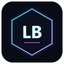
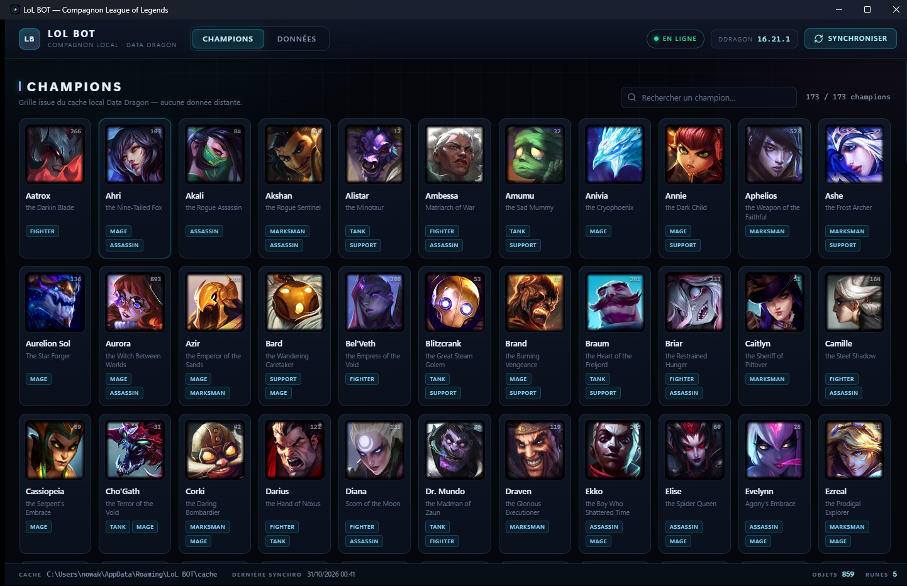
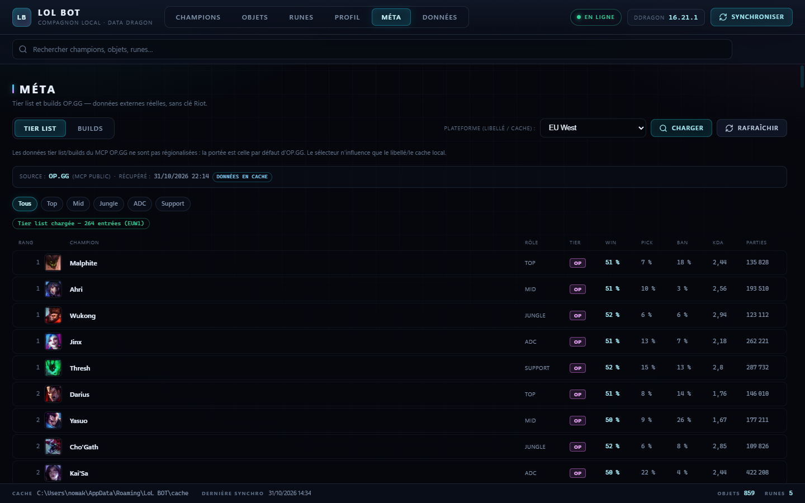
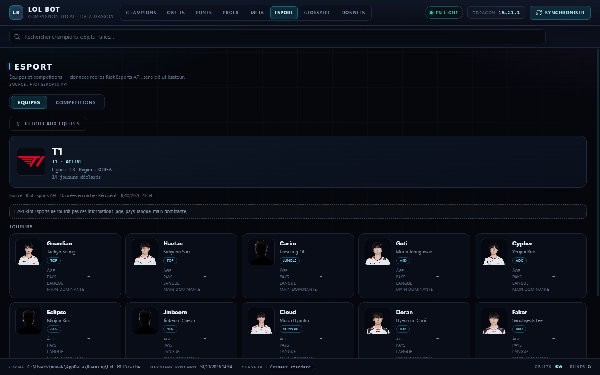
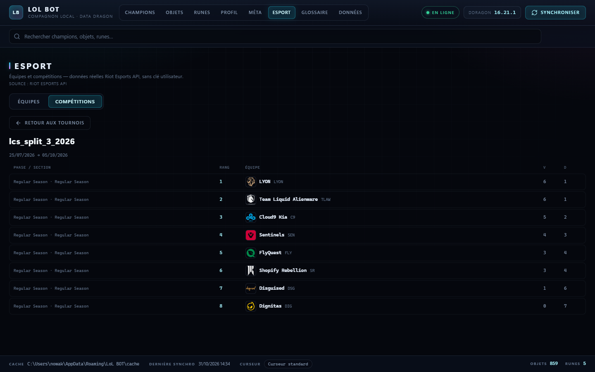
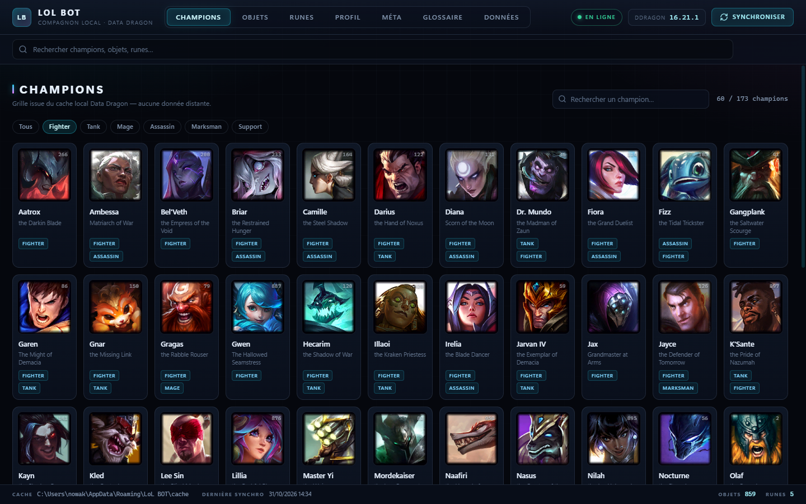
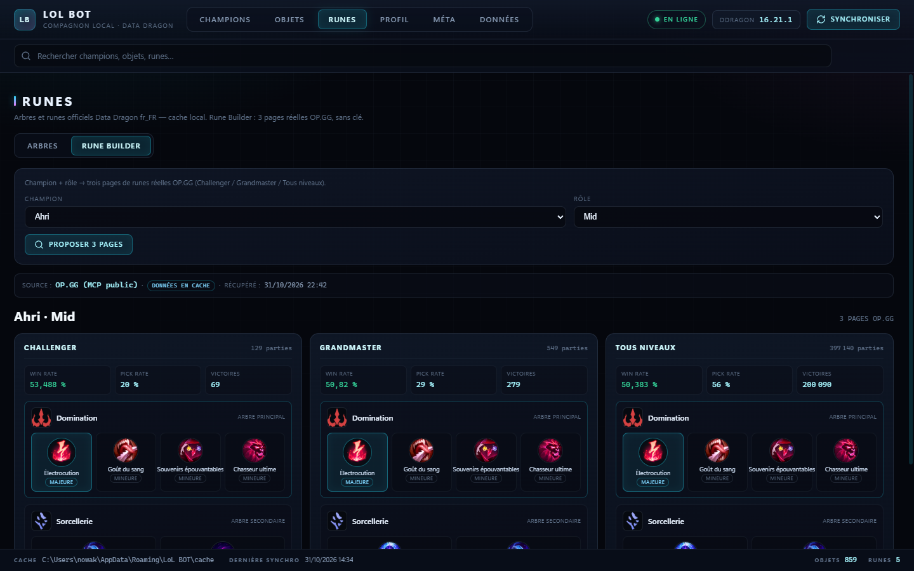
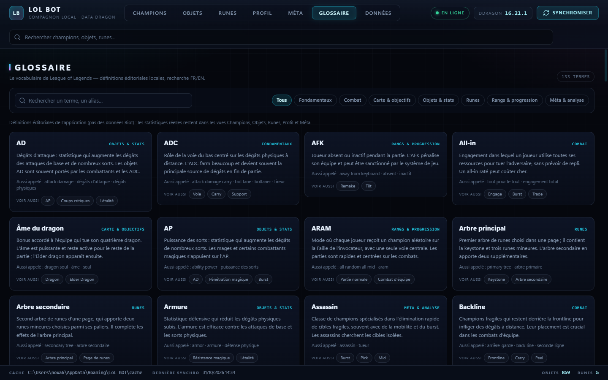
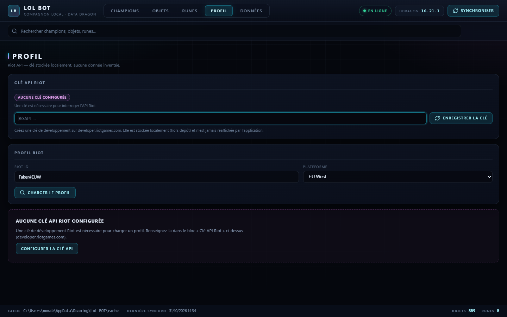

<p align="center">
  
</p>

<h1 align="center">LoL BOT — Compagnon local pour League of Legends</h1>

<p align="center">
  <em>Champions, objets, runes, profil, méta, esport et glossaire — dans une app Windows native, rapide et 100&nbsp;% locale.</em>
</p>

<p align="center">
  <a href="https://github.com/Tomoushie/LoL-Companion/releases/latest"></a>
  <a href="https://github.com/Tomoushie/LoL-Companion/releases"></a>
  <a href="https://github.com/Tomoushie/LoL-Companion/stargazers"></a>
  <a href="https://github.com/Tomoushie/LoL-Companion/issues"></a>
</p>

<p align="center">
  
  
  
  
</p>

<p align="center">
  <a href="https://github.com/Tomoushie/LoL-Companion/releases/latest"><b>⬇️ Télécharger pour Windows</b></a>
  &nbsp;·&nbsp;
  <a href="#installation"><b>📦 Installation</b></a>
  &nbsp;·&nbsp;
  <a href="https://github.com/Tomoushie/LoL-Companion/issues/new"><b>🐞 Signaler un bug</b></a>
  &nbsp;·&nbsp;
  <a href="mailto:nowaktombe@protonmail.com"><b>✉️ Contact</b></a>
</p>

---

## C'est quoi LoL BOT ?

**LoL BOT** est un compagnon desktop **Windows** pour League of Legends, construit avec **Rust + Tauri 2**.
Il rassemble les informations utiles autour du jeu dans une interface sombre et rapide : catalogue
**Data Dragon** (champions, objets, runes), **Rune Builder** avec pages réelles OP.GG, **tier list** et
**builds méta**, **profil Riot** (rang, LP, matchs, progression), **onglet Esport** (équipes,
compétitions, classements Riot Esports), **glossaire** intégré, **curseur personnalisé** et recherche
globale.

L'application est **locale par défaut** : les données statiques sont mises en cache sur le disque et
consultables hors ligne. Aucun compte n'est créé, aucune télémétrie n'est envoyée. La clé Riot API est
**optionnelle** et stockée uniquement sur votre machine ; elle est nécessaire pour le profil et la
progression.

> 🎯 **Lecture seule. Locale. Sans bot.** LoL BOT ne se connecte pas à votre compte de jeu, ne clique
> pas à votre place et n'automatise aucune action en partie. Projet communautaire non affilié à Riot
> Games.

<p align="center">
  
</p>
<p align="center"><em>Champions, objets et runes issus du cache local Data Dragon.</em></p>

## Pourquoi LoL BOT ?

- **Tout le catalogue local** — 173 champions, 859 objets, 5 arbres de runes et 62 runes, avec fiches
  détaillées, icônes et recherche globale.
- **Un vrai Rune Builder** — 3 pages de runes réelles OP.GG (Challenger / Grandmaster / Tous niveaux)
  pour le champion et le rôle choisis.
- **La méta sans clé** — tier list et builds OP.GG réels, avec cache et attribution de source.
- **Votre profil Riot** — rang/LP, 10 derniers matchs, fiche de match et progression sur 50 matchs
  (win rate par champion, rôle et serveur) **avec votre clé**.
- **Un glossaire pour débuter** — 133 termes expliqués, recherche FR/EN, catégories et liens.
- **Un onglet Esport** — 1 193 équipes actives, 51 ligues, tournois et classements réels via la Riot
  Esports API.
- **Un curseur personnalisé** — crosshair cyan local, activable depuis le pied de page et mémorisé.
- **Rapide et natif** — Rust/Tauri 2, pas d'Electron, pas de serveur, pas de compte.

<p align="center">
  
</p>
<p align="center"><em>Tier list OP.GG réelle, filtrable par rôle, avec win/pick/ban rates et cache local.</em></p>

<p align="center">
  
</p>
<p align="center"><em>Esport : fiche T1, joueurs réels et champs non fournis affichés « — ».</em></p>

<p align="center">
  
</p>
<p align="center"><em>Compétitions : tournois et classements réels (LCS 2026, victoires/défaites).</em></p>

## Captures d'écran

<p align="center">
  
</p>
<p align="center"><em>Filtres par classe Data Dragon (V0.9) : 60 combattants sur 173 champions.</em></p>

<p align="center">
  
</p>
<p align="center"><em>Rune Builder : trois pages réelles OP.GG pour Ahri Mid.</em></p>

<p align="center">
  
</p>
<p align="center"><em>Glossaire intégré : 133 termes, 7 catégories, recherche FR/EN et liens entre termes.</em></p>

<p align="center">
  
</p>
<p align="center"><em>Profil Riot : la clé se saisit dans l'app et reste stockée localement.</em></p>

## Fonctionnalités

### Gratuit

| Fonctionnalité | Ce qu'elle fait |
|---|---|
| **Catalogue Data Dragon** | 173 champions, 859 objets, 5 arbres / 62 runes, icônes locales et fiches détaillées. |
| **Recherche globale** | Champions, objets et runes depuis une seule barre, navigation clavier. |
| **Filtres par classe** | Fighter, Tank, Mage, Assassin, Marksman, Support sur la grille des champions (V0.9). |
| **Rune Builder** | 3 pages de runes réelles OP.GG selon champion + rôle, avec runes, fragments et taux. |
| **Tier list & builds méta** | Données OP.GG réelles (MCP public), cache 6 h / 12 h, source affichée. |
| **Profil Riot** | Clé locale optionnelle : rang/LP, 10 derniers matchs, fiche de match détaillée. |
| **Progression personnelle** | Win rate par champion, par rôle et par serveur sur les 50 derniers matchs. |
| **Glossaire** | 133 termes, 7 catégories, recherche FR/EN, liens « Voir aussi ». |
| **Esport** | 1 193 équipes actives, 51 ligues, joueurs, tournois et classements réels (Riot Esports API). |
| **Curseur personnalisé** | Crosshair cyan local, bascule dans le pied de page, préférence mémorisée. |
| **Cache local** | Data Dragon, Riot, OP.GG et Esport mis en cache ; consultation hors ligne des données statiques. |
| **Thème cyber** | Interface sombre native, responsive 1080×700 minimum. |

### Demande V1.0 non livrée dans cette version

| Demande | Statut / raison |
|---|---|
| **Combinaisons de runes interactives** (stats apportées au champion) | Non livré : Data Dragon fournit les arbres et descriptions, pas les valeurs numériques des runes ni les ratios sorts/champion nécessaires pour calculer un impact fiable. Le Rune Builder propose déjà 3 pages réelles OP.GG. |
| **Effets d'un objet sur un champion** (stats/sorts) | Non livré : les stats d'objet et de champion sont disponibles, mais les ratios des sorts ne sont pas exposés par Data Dragon ; un calcul complet serait une estimation. La fiche objet détaille déjà les stats réelles. |
| **Runes recommandées sur la liste des champions** | Non livré : cela demanderait un appel OP.GG par champion (173) ou un gros cache ; le Rune Builder le fait déjà à la demande. |
| **Âge/pays/langue/main dominante des joueurs esport, trophées** | Non fournis par l'API Riot Esports ; l'app affiche « — » et une note explicite plutôt que d'inventer. Leaguepedia a été testé mais renvoie un rate-limit sans accès garanti. |

### À venir

- **Mode Streamer** — overlay OBS (version de base gratuite, personnalisation plus tard).
- **Farm Optimizer** — analyse de rentabilité du farm à partir de vos matchs réels (nécessite votre clé
  Riot et une source de données adaptée).

> Il n'y a **pas de premium payant** dans cette version : toutes les fonctionnalités listées ci-dessus
> sont gratuites. Le dépôt est un projet communautaire open source.

## Installation

### Prérequis

- **Windows 10 ou 11 (x64)**.
- **WebView2 Runtime** (généralement déjà présent sur Windows 10/11 ; sinon, installez-le depuis le
  site de Microsoft).
- Aucun compte, aucun backend, aucun serveur à lancer.

### Depuis la dernière release

1. Ouvrez la page **[Dernière release](https://github.com/Tomoushie/LoL-Companion/releases/latest)**.
2. Téléchargez **un** des fichiers :
   - **`LoL.BOT_1.0.0_x64-setup.exe`** — installateur NSIS, **recommandé** ;
   - **`LoL.BOT_1.0.0_x64_en-US.msi`** — paquet MSI pour les déploiements Windows ;
   - **`lol-bot.exe`** — exécutable portable (aucune installation).
3. Lancez l'installateur (ou l'exe portable) et ouvrez **LoL BOT**.
4. Vérifiez éventuellement l'intégrité avec **`SHA256SUMS`** (fourni avec la release) :

```powershell
Get-FileHash -Algorithm SHA256 ".\LoL.BOT_1.0.0_x64-setup.exe"
```

Le fichier `SHA256SUMS` contient les empreintes SHA-256 des trois fichiers publiés.

> **Windows SmartScreen** : l'application n'est **pas signée** (certificat de signature de code non
> fourni). Windows peut afficher « Windows a protégé votre PC ». Cliquez sur **Informations
> complémentaires → Exécuter quand même** si vous faites confiance à la release. Vérifiez les
> checksums ci-dessus.

### Premier lancement

- L'app télécharge et met en cache les données **Data Dragon** au premier démarrage (champions, objets,
  runes, icônes). Les lancements suivants sont locaux.
- Les onglets **Champions / Objets / Runes / Méta / Esport / Glossaire** fonctionnent sans clé.
- Pour **Profil** et **Progression** : créez une clé de développement sur
  <https://developer.riotgames.com/>, ouvrez **Profil → Clé API Riot**, collez-la et enregistrez.
  La clé est stockée dans `%APPDATA%\LoL BOT\config\riot_api_key` et n'est jamais envoyée ailleurs
  qu'à l'API Riot officielle. Elle expire généralement au bout de 24 h ; régénérez-la si besoin.

## Données, sources et confidentialité

| Source | Usage | Clé requise |
|---|---|---|
| **Data Dragon** (Riot) | champions, objets, runes, icônes, fiches | Non |
| **Riot API** | profil, matchs, fiche de match, progression 50 matchs | **Oui** (la vôtre) |
| **OP.GG MCP public** | tier list, builds, pages de runes | Non |
| **Community Dragon** | libellés des fragments de stats | Non |
| **Riot Esports API** | équipes, ligues, joueurs, tournois, classements | Non (clé publique cliente) |

- **100 % local** : cache dans `%APPDATA%\LoL BOT\cache`, clé Riot dans
  `%APPDATA%\LoL BOT\config`. Aucune télémétrie, aucun analytics, aucun compte.
- **Aucune donnée inventée** : quand une valeur n'est pas disponible, l'app affiche `—`.
- **Pas d'accès au jeu** : aucun scan mémoire, aucun overlay temps réel dans cette version, aucun
  contournement d'API.
- **Sources tierces** : OP.GG MCP et Riot Esports sont des services publics tiers, non officiels Riot ;
  les données sont mises en cache avec attribution. LoL BOT n'est affilié ni à Riot Games ni à OP.GG.
  Les logos/photos esport sont chargés depuis les CDN Riot (URLs distantes) uniquement dans l'onglet
  Esport ; le reste de l'app reste local.

## FAQ

**Faut-il une clé Riot API ?**
Non pour le catalogue, les runes, la méta, le glossaire et la recherche. Oui pour le profil Riot, les
matchs et la progression. La clé est gratuite et reste locale.

**L'app fonctionne-t-elle hors ligne ?**
Oui pour les données déjà en cache (Data Dragon, fiches, glossaire). La méta OP.GG et les données Riot
nécessitent une connexion (ou un cache existant) pour se rafraîchir.

**Pourquoi Windows affiche-t-il un avertissement SmartScreen ?**
L'exe n'est pas signé. Vérifiez le SHA-256 et cliquez sur « Informations complémentaires → Exécuter
quand même » si vous faites confiance à la release.

**Pourquoi mon rang ne s'affiche-t-il pas ?**
Vérifiez la clé (elle expire), le Riot ID et le serveur. Les erreurs Riot réelles (401, 404, 429) sont
affichées telles quelles, sans valeur inventée.

**Pourquoi la progression est-elle limitée à 50 matchs ?**
L'API Riot impose un rate-limit ; l'app se limite aux 50 derniers matchs pour rester dans les quotas et
répondre rapidement. Le cache évite de tout retélécharger.

**Où sont stockées mes données ?**
Tout dans `%APPDATA%\LoL BOT\` (cache + clé). Rien dans le dépôt, rien sur un serveur LoL BOT.

**Puis-je contribuer ?**
Oui : ouvrez une issue, proposez une pull request ou signalez un bug via GitHub. Voir
[CONTRIBUTING.md](CONTRIBUTING.md).

**Pourquoi certains joueurs esport ont-ils des champs « — » ?**
L'API Riot Esports fournit le pseudo, le nom, le rôle et la photo, mais pas l'âge, le pays, la langue,
la main dominante ni les trophées. L'app ne les invente pas et l'indique explicitement.

## Feuille de route

- ✅ V0.1 — Data Dragon + catalogue champions
- ✅ V0.2 — objets, fiches champions, recherche
- ✅ V0.3 — runes
- ✅ V0.4 — fiches objets/runes, recherche globale
- ✅ V0.5 — Riot API, profil, matchs
- ✅ V0.6 — progression, tier list, builds
- ✅ V0.7 — Rune Builder
- ✅ V0.8 — Glossaire
- ✅ V0.9 — filtres par classe, release NSIS/MSI, dépôt GitHub
- ✅ V1.0 — onglet Esport, curseur personnalisé, CONTRIBUTING, CODE_OF_CONDUCT, licence explicite
- 🚧 Combinaisons de runes, effets d'objet sur champion (données manquantes)
- 🚧 Mode Streamer (overlay OBS)
- 🚧 Farm Optimizer (analyse de farm basée sur vos matchs)

## Stack technique

- **Rust** — backend Tauri, cache local, client Riot API, rate-limit, client MCP OP.GG, client Riot
  Esports, parsing.
- **Tauri 2** — coquille native Windows, protocole d'assets local, sécurité CSP.
- **Vanilla TypeScript / CSS** — interface sans framework lourd, thème sombre « cyber ».
- **Données** — Data Dragon, Riot API, OP.GG MCP public, Community Dragon, Riot Esports API.
- **Tests** — 75 tests Rust sans réseau, e2e CDP (UI, cache, données réelles OP.GG/Esport),
  vérification d'intégrité du cache Data Dragon.

## Contribuer

- ⭐ **Star** le dépôt s'il vous est utile.
- 🐞 **Signaler un bug** via [GitHub Issues](https://github.com/Tomoushie/LoL-Companion/issues).
- 💡 **Proposer une fonctionnalité** par issue.
- 🔐 **Signaler un problème de sécurité** en privé par e-mail.
- 📖 Lire [CONTRIBUTING.md](CONTRIBUTING.md) pour cloner, tester et proposer une pull request.
- 🤝 Le projet suit le [CODE_OF_CONDUCT.md](CODE_OF_CONDUCT.md).

## Licence

**Ce projet est distribué sous licence MIT. Vous êtes libre de l'utiliser, de le modifier et de le
redistribuer, tant que vous conservez la mention de copyright.**

Le texte complet est disponible dans [LICENSE](LICENSE). En contribuant, vous acceptez que votre
contribution soit distribuée sous cette même licence.

## Contact

- **Email :** nowaktombe@protonmail.com
- **Bugs :** [GitHub Issues](https://github.com/Tomoushie/LoL-Companion/issues)
- **Dépôt :** <https://github.com/Tomoushie/LoL-Companion>

---

<p align="center">
  <b>LoL BOT</b> — votre compagnon local pour League of Legends.<br/>
  Fait avec ❤️ pour la communauté LoL.
</p>

<p align="center">
  <sub>LoL BOT n'est pas affilié à Riot Games. League of Legends et tous les assets associés sont la
  propriété de Riot Games, Inc. Données statiques : Data Dragon. Données de joueur : Riot API officielle
  (votre clé). Données méta : OP.GG via son serveur MCP public. Le glossaire est un contenu éditorial
  local.</sub><br/>
  <sub>Distribué sous licence MIT — voir <a href="LICENSE">LICENSE</a>.</sub>
</p>
